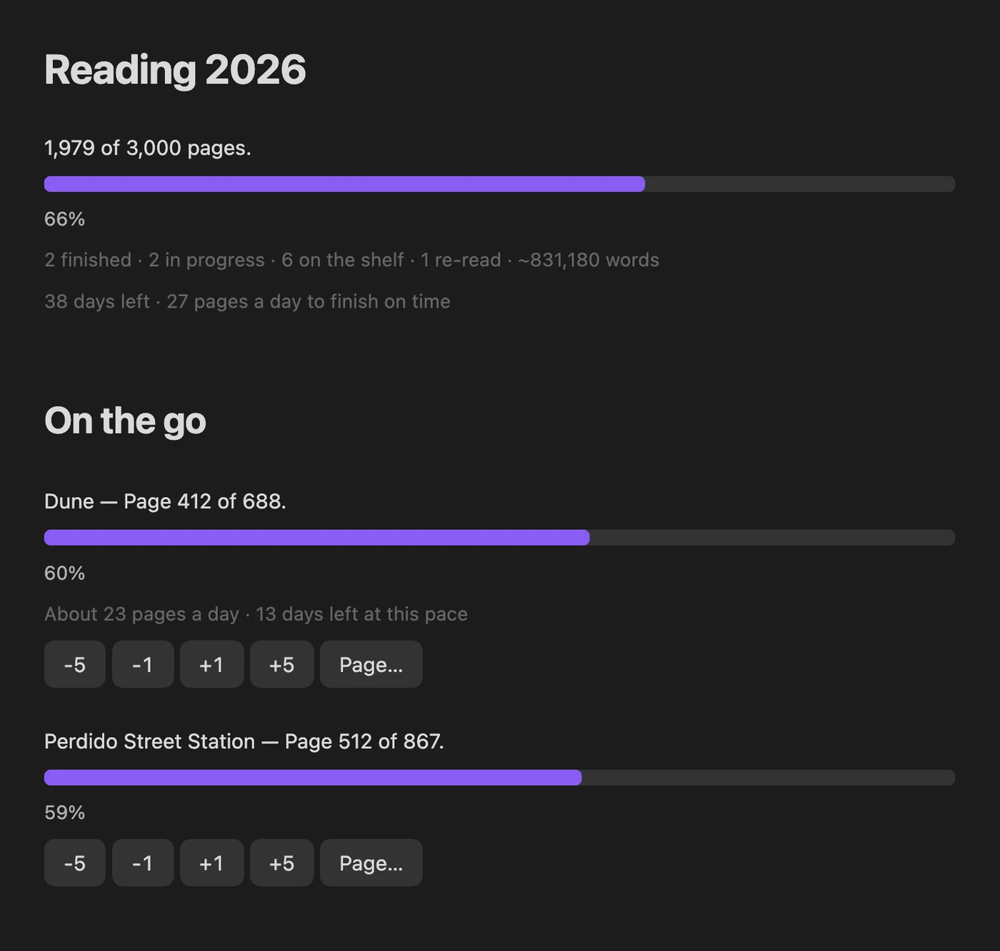
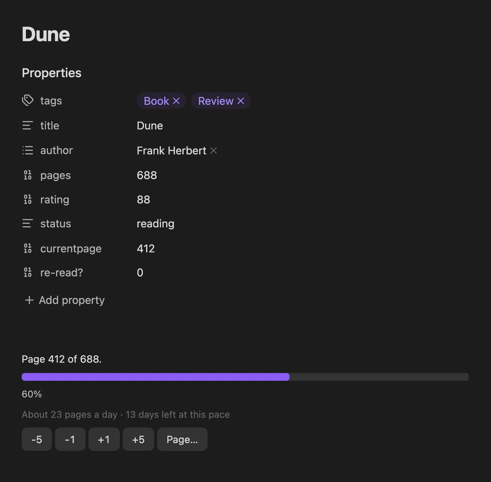
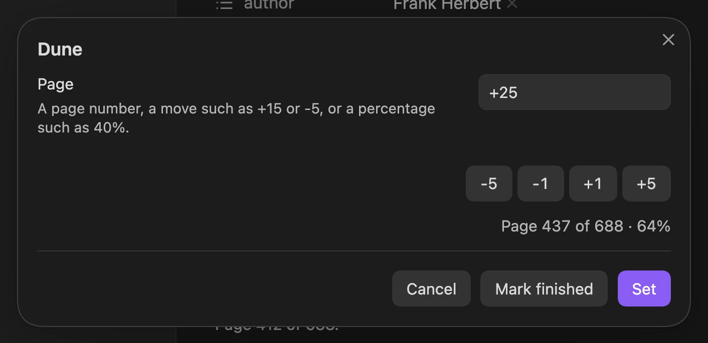
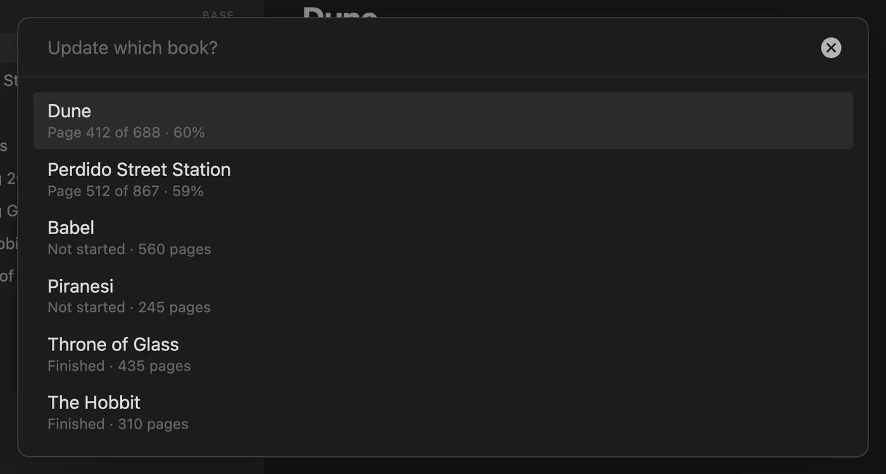
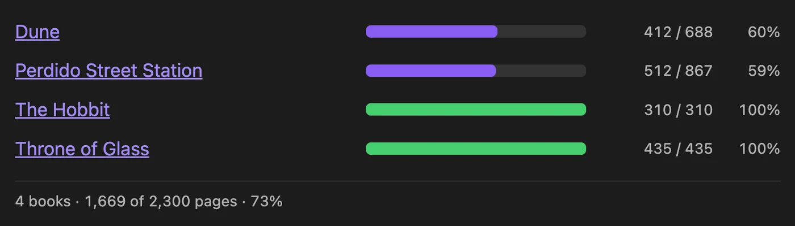
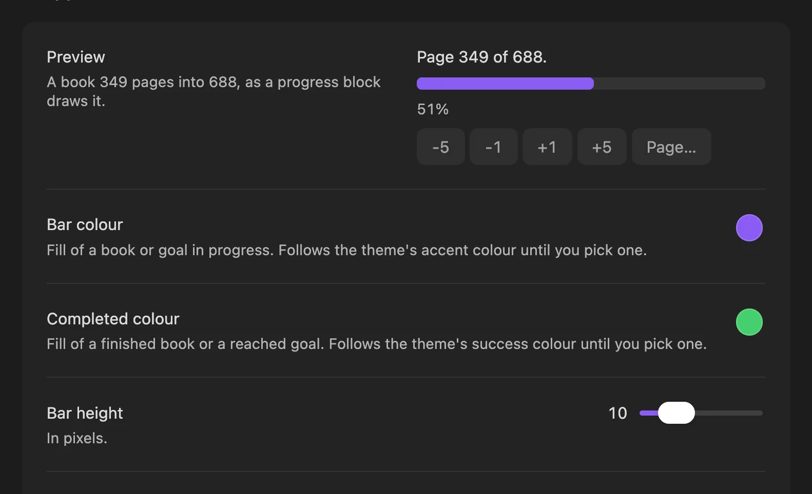

# Reading Goal

Track how far you are through each book, and how far you are toward a goal, from the properties in your Obsidian notes. It is built for reading, and works for anything with a total and a current number.



Reading Goal reads a book note's length and your current page from its properties and draws a progress bar from them. Buttons, commands and hotkeys move the page number, and the status property is updated as you start and finish a book. A second block adds up every book in the vault against a goal you set.

Your data stays in plain properties in your own notes. The plugin works without Dataview, Meta Bind or any other community plugin.

Books are the starting point, but nothing in the plugin depends on them. The property names, the tag and the label text can all be changed, so the same bar can count lectures in a course, episodes of a show or chapters of a draft. See [Tracking other things](#tracking-other-things).

## Install

Reading Goal has a page in the [Obsidian community directory](https://community.obsidian.md/plugins/reading-goal), with an **Add to Obsidian** button. It needs Obsidian 1.10 or later.

If it does not come up yet when you search for it under Settings → Community plugins → Browse, install it with BRAT or by hand.

**With BRAT**

1. Install [BRAT](https://github.com/TfTHacker/obsidian42-brat) from the community plugins.
2. In BRAT, add a beta plugin and paste `https://github.com/VSHT3/obsidian-reading-goal`.
3. Turn on **Reading Goal** under Settings → Community plugins.

**By hand**

1. Download `main.js`, `manifest.json` and `styles.css` from the [latest release](https://github.com/VSHT3/obsidian-reading-goal/releases/latest).
2. Put the three files in `<your vault>/.obsidian/plugins/reading-goal/`.
3. Reload Obsidian and turn on **Reading Goal** under Settings → Community plugins.

## Quick start

1. Open the note for a book you are reading and run **Reading Goal: Track this note as a book** from the command palette. Enter the book's length and the page you are on.
2. Add a progress block anywhere in that note:

   ````markdown
   ```reading-progress
   ```
   ````

3. Add a goal block to any note you like, for example a reading dashboard:

   ````markdown
   ```reading-goal
   ```
   ````

4. Set your page goal under Settings → Reading Goal.

Step 1 writes this to the note. You can also type it yourself:

```yaml
---
tags:
  - Book
pages: 688        # the book's length
currentpage: 412  # the page you are on
status: reading   # to read, reading or finished
---
```

If your book notes already use other property names, see [Using notes you already have](#using-notes-you-already-have).



## Updating your page

There are several ways to move your position, and they all write the same `currentpage` property. The bar redraws as soon as the property changes, including when you edit it by hand. A position is always kept between 0 and the book's length.

### Buttons

The row under the bar steps back or forward by a small or a large amount, 1 and 5 pages by default. Both step sizes are settings. You can hide the rewind buttons, or the whole row.

### The page prompt

**Page…** opens a prompt for larger moves.



| You type | You get |
| --- | --- |
| `437` | Page 437 |
| `+25` or `-10` | 25 pages forward, or 10 back |
| `50%` | Halfway through the book |

The line under the field shows the page and percentage you are about to set. The step buttons change the number in the field, for phone keyboards that have no plus key. **Mark finished** jumps to the last page.

### Commands and hotkeys

None of the commands has a hotkey out of the box. Assign your own under Settings → Hotkeys.

| Command | What it does |
| --- | --- |
| Advance position by small step | +1 page by default |
| Rewind position by small step | -1 page by default |
| Advance position by large step | +5 pages by default |
| Rewind position by large step | -5 pages by default |
| Set position to a specific page | Opens the page prompt |
| Mark book as finished | Jumps to the last page |
| Start a re-read | Adds one to the re-read count and returns to page 0 |
| Update position for any book | Pick a book and set its page |
| Open a book | Pick a book and open its note |
| Track this note as a book | Sets up a note that has no page count |
| Insert book progress block | Builds a block and inserts it at the cursor |
| Insert vault goal block | The same, for the goal |
| Create books base | Creates the base, or opens it if it exists |
| Show progress toward page goal | Shows the goal total in a notice |

The first seven act on the note you have open, and appear in the palette only when that note has a page count. The four step commands repeat while you hold the hotkey down.

### From any note

**Update position for any book** lets you log tonight's pages without opening the book's note first. Books you are reading come first, the most recently edited on top, followed by books you have not started and books you have finished.



### Status bar and ribbon

While a book note is open, the status bar shows its position, for example `412 / 688 · 60%`. It updates when you press a step hotkey, and a click on it opens the page prompt. Obsidian's mobile app has no status bar.

The book icon in the ribbon opens a menu with the goal total, actions for the book you have open, the two pickers, and shortcuts for inserting a block, opening the base and opening settings.

### What happens to the status

With **Update status automatically** on, the status property changes with your position:

| When you | The status becomes |
| --- | --- |
| Reach the last page | `finished` |
| Move back from the last page | `reading` |
| Move forward from page 0, or from an empty or `to read` status | `reading` |
| Go back to page 0 | `to read` |

The three values are settings. Any other status you have written yourself, such as `abandoned`, is left as it is.

## The goal

The goal block adds up every note that carries the book tag and compares the total with your page goal.

- A finished book counts for its full length. A book is finished when its status is the finished value or its position is on the last page.
- A book in progress counts for the pages you have read so far. Turn off **Count books in progress** to count finished books only.
- The line under the bar shows how many books are finished, in progress and on the shelf, with an estimate of words read. Set **Words per page** to 0 to drop the estimate.

### A deadline

Set **Goal deadline** to a date such as `2026-12-31` and the block adds a line showing the days left and the pages a day it takes to get there, as in the first screenshot. Today and the deadline day both count as reading days. After the date has passed, the line shows how many days ago that was and how many pages you are short. It disappears when you reach the goal.

### Re-reads

**Start a re-read** adds one to the note's re-read count, returns it to page 0 and marks it as being read again. The book keeps the pages from your first read, so starting a re-read never lowers your total.

By default a book counts once, however many times you read it. With **Count re-reads toward the goal** on, every pass counts. A 310-page book read twice is worth 620 pages, and a re-read in progress adds its pages as you go.

## Reading log and pace

A single page number cannot tell you what you read last month. Turn on **Keep a dated reading log** and each change of position also writes a dated line into the note:

```markdown
## Reading log

- 2026-11-14: 208
- 2026-11-17: 281
- 2026-11-20: 356
```

There is one line per day and it is rewritten in place, so holding a hotkey produces one entry. The section is added at the end of the note if it is missing. The setting is off by default because it edits the body of your notes, where everything else only touches properties.

With the log on, a book in progress shows your pace under its bar, for example "About 23 pages a day · 13 days left at this pace". The pace is the pages read since the earliest log entry in the last 30 days, divided by the days from that entry to today. It is measured to today, so it falls while a book sits untouched. It appears once the log has an entry from before today.

## Several books in one note

A progress block normally tracks the note it sits in. Give it a `file` and it tracks another note, with buttons that write to that note:

````markdown
```reading-progress
file: Dune
```

```reading-progress
file: Perdido Street Station
```
````

The dashboard at the top of this page is built this way.

## Tracking other things

A progress block needs two numbers in a note: a total and a current position. Which properties hold them is up to you, and so is the text above the bar. A block can name its own properties, so one vault can hold books next to other things:

````markdown
```reading-progress
pages: lectures
current: watched
label: Lecture {current} of {total}
```
````

In a note with `lectures: 24` and `watched: 9`, this draws a bar at 38% with the same step buttons. Moving the position still writes the status property, unless **Update status automatically** is off.

The names set on a block apply to that block and its buttons. The commands, the status bar, the goal total and the books base use the tag and property names from settings. To use those for something other than books, change the names under Settings → Reading Goal → Book notes.

## The books base

**Create books base** writes a [Bases](https://help.obsidian.md/bases) file over every note with the book tag and opens it. It has five views:

| View | Shows |
| --- | --- |
| Reading now | A bar, percentage, page, length and pages left for each book in progress |
| Finished | Finished books, with total pages and estimated words |
| To read | The queue, with total pages |
| Shelf | Every book as a card |
| Progress bars | A bar for each book with progress, in the plugin's own view |



The first four views are plain Bases and keep working if you remove the plugin. **Progress bars** needs the plugin and the Bases core plugin turned on.

The base is written using your current property names. If you rename a property later, delete the base and create it again.

## Customising

Everything has a default under Settings → Reading Goal. A block can override most of them for itself.



### Settings

| Section | What you can change |
| --- | --- |
| Goal | Page goal (10,000 to begin with), deadline, whether books in progress count, words per page |
| Book notes | The book tag and the property names, with a count of the notes they match |
| Status | Automatic updates and the three status values |
| Controls | The button row, both step sizes, rewind buttons, the page button |
| Appearance | Bar colour, completed colour, bar height, percentage, label text for books and for the goal, the goal's details line |
| Status bar | Whether it shows, and its text |
| Re-reads | The count property, and whether re-reads count toward the goal |
| Reading log | Whether to keep it, its heading and date format, the pace and how many days it looks back |
| Base | Where the books base is saved |

A preview at the top of Appearance redraws as you change colours, height, label and buttons. Colours you leave alone follow your theme.

A value that cannot work is not saved, and a message under the field says why. That covers text in a number field, a date in the wrong format, a misspelt placeholder, and a name that another property or status already uses. Each field you have changed gets a button that restores its default, and **Restore all defaults** at the bottom resets the page. Neither changes your notes.

### Block options

Options go inside a block as `key: value` lines. Leave an option out and the block follows your settings. Lines that start with `#` are comments. A key the plugin does not know is named in the rendered block, so a typo shows up in the note.

````markdown
```reading-progress
file: Dune
small: 10
large: 50
color: #00A5FF
height: 22
percent: false
```
````

| `reading-progress` option | Meaning |
| --- | --- |
| `file` | Track another note. Takes a note name or a `[[wikilink]]` |
| `pages`, `current`, `status` | Property names to use for this block |
| `small`, `large` | Step sizes |
| `buttons` | Show the button row |
| `plus`, `minus` | Show the forward or the back buttons |
| `set` | Show the **Page…** button |
| `pace` | Show the pace line |
| `percent` | Show the percentage |
| `label` | `false` to hide the label, or your own text (see below) |
| `color` | Any CSS colour |
| `height` | Bar height in pixels |

| `reading-goal` option | Meaning |
| --- | --- |
| `goal` | Page goal for this block |
| `deadline` | A date such as `2026-12-31`, or `none` to ignore the deadline in settings |
| `tag` | Book tag to count |
| `inprogress` | Count books in progress |
| `words` | Words per page. `0` hides the estimate |
| `details` | Show the line of book counts |
| `percent`, `label`, `color`, `height` | As above |

On/off options accept `true` and `false`, `yes` and `no`, `on` and `off`, `1` and `0`, or `show` and `hide`.

If you would rather not type options, **Insert book progress block** and **Insert vault goal block** open a form that builds the block for you. It writes only the options that differ from your settings.

### Label text

The text above a bar can be your own, either for every block (**Book label** and **Goal label** in settings) or for one block with `label`. Placeholders in braces are replaced with live values:

````markdown
```reading-progress
label: {title}: {current} of {total}, {remaining} to go
```
````

| For a book | For the goal |
| --- | --- |
| `{current}` `{total}` `{remaining}` | `{read}` `{goal}` `{remaining}` |
| `{percent}` `{title}` `{status}` | `{percent}` `{books}` `{finished}` `{inprogress}` |
| `{words}` | `{words}` `{rereads}` |
| | `{deadline}` `{daysleft}` `{pace}` |

Numbers come with thousands separators. A placeholder that does not exist is left in the label and named underneath it. The status bar text takes the book placeholders too.

## Using notes you already have

You do not have to rename anything. Under Settings → Reading Goal → Book notes, enter the tag and the property names your notes already use. **Matching notes** underneath shows how many notes the plugin finds with them, for example `6 tagged #Book · 6 with a numeric "pages"`.

- The tag is matched without regard to capitals, in properties or in the note body.
- A page count written as text, such as `pages: "435"`, is read as a number.
- A note with the tag but no page count still counts as a book on the shelf. Its progress block offers a **Set up as a book** button.

## Mobile

Reading Goal is not limited to desktop. On phones and tablets the buttons are larger and share the row evenly, and the page prompt asks for the number keyboard. So far this has been checked in Obsidian's mobile emulation and not on a device, so reports from real phones are welcome.

## Troubleshooting

**The block says the note has no numeric page count.** Add a `pages` property with a number, or press **Set up as a book**.

**The position commands are missing from the command palette.** They appear only when the open note has a page count.

**The block says it ignored an unknown option.** Check the spelling of the key against the tables above.

**The Progress bars view is missing from the base.** Turn on the Bases core plugin.

**The base shows empty columns after renaming a property.** Delete the base and run **Create books base** again.

## Feedback

Bug reports and suggestions are welcome in the [issue tracker](https://github.com/VSHT3/obsidian-reading-goal/issues). It helps to include your Obsidian version, whether you are on desktop or mobile, and the block as you wrote it.

## Development

```sh
npm install
npm run dev     # watch build
npm run build   # typecheck and production bundle
npm test        # logic tests, no Obsidian needed
npm run lint
```

`npm test` runs the plugin's logic against an in-memory stand-in for the Obsidian API in `test/obsidian-stub.ts`. Changes are listed in [CHANGELOG.md](CHANGELOG.md).

## Licence

[MIT](LICENSE)
